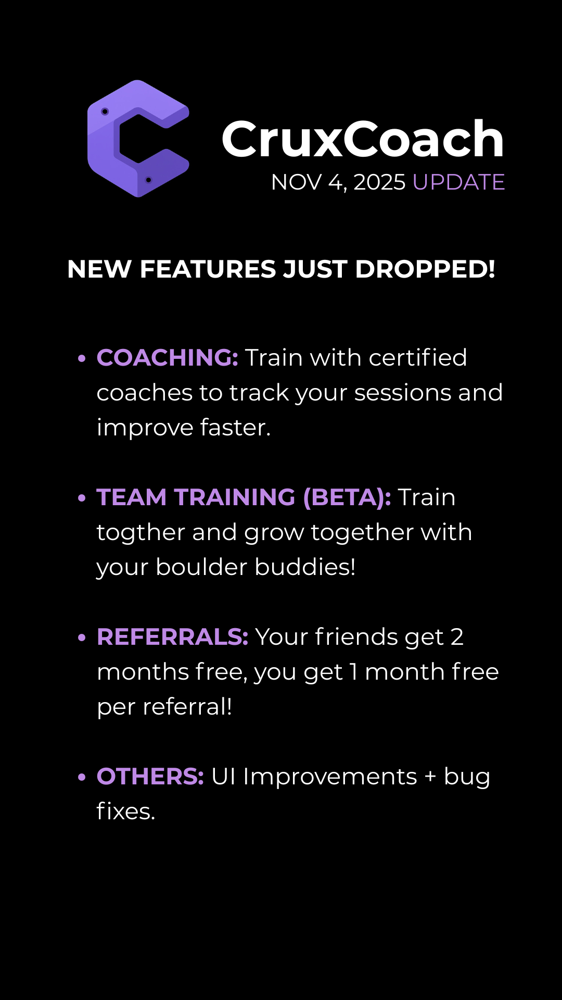

# CruxCoach

A bouldering training app that helps climbers break through plateaus and avoid injury by training across six performance areas:

1. Finger strength
2. Pulling power and grip strength
3. Flexibility
4. Footwork
5. Movement and technique
6. Mental game

Co-founded under **S.P. Solutions**. Source code is private; this repo is a project showcase.

## Problems it targets
- **Plateaus**: climbers stuck at the same grade for months without knowing what is holding them back
- **Injury risk**: finger and shoulder injuries from unstructured training
- **Inefficient sessions**: climbing often without measurable progress
- **Technique gaps**: muscling through problems instead of moving efficiently

## Features
- Structured training across the six areas
- Coaching: train with certified coaches who track your sessions
- Team training (beta): train together with climbing partners
- Referral system

